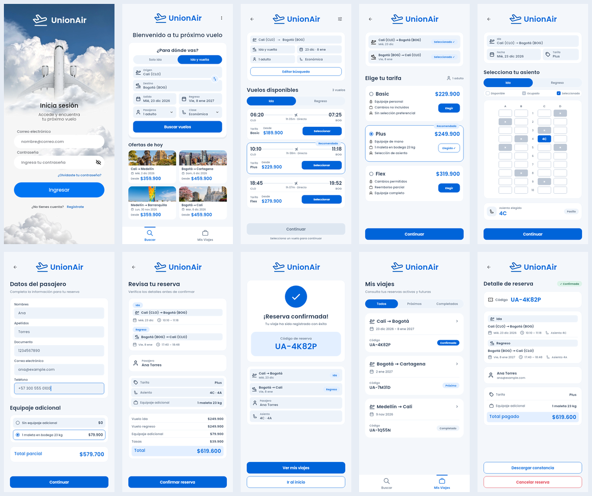

# Evidencias de UnionAir

## Pantallas

Las capturas se generaron desde los widgets en ejecución con Flutter 3.50.1. El recorrido principal usa un área de 440 × 956 px, igual que los marcos de referencia. [Diseño en Figma](https://www.figma.com/design/THsDDkUES4sgdIB1kzRBOU/Untitled)

| Inicio y búsqueda | Selección | Reserva y seguimiento |
| --- | --- | --- |
| [Login](capturas/01-login.png) | [Resultados](capturas/03-resultados.png) | [Revisión](capturas/07-revision.png) |
| [Buscar](capturas/02-buscar.png) | [Tarifa](capturas/04-tarifa.png) | [Confirmación](capturas/08-confirmacion.png) |
| | [Asiento](capturas/05-asiento.png) | [Mis viajes](capturas/09-mis-viajes.png) |
| | [Pasajero](capturas/06-pasajero.png) | [Detalle](capturas/10-detalle.png) |

## Registro previo de verificación

| Caso | Resultado esperado | Resultado obtenido |
| --- | --- | --- |
| Acceso válido e inválido | Las credenciales inválidas muestran un error y las válidas abren Buscar. | Verificado a 320 y 440 px. El usuario pudo corregir la contraseña y continuar. |
| Ruta inválida y búsqueda vacía | Se rechaza un origen igual al destino. Una ruta sin vuelos muestra el estado vacío y permite editar. | Verificado. La búsqueda conservó el destino al volver al formulario. |
| Reserva de ida y vuelta | Se eligen ambos vuelos, tarifa y asientos disponibles. Un asiento ocupado queda bloqueado. | Verificado a 320 y 440 px. El resumen mostró ambos asientos y el total esperado de $619.600. |
| Datos incompletos y teclado | El formulario informa qué campos faltan. El botón sigue accesible con el teclado abierto. | Verificado a 320 × 650 y 440 × 956 px con un teclado simulado de 260 px. [Vista del formulario compacto](capturas/11-pasajero-con-teclado.png) |
| Confirmación duplicada | Confirmar dos veces el mismo borrador conserva la referencia y registra una sola reserva. | Verificado en el servicio de reservas. |
| Seguimiento y cancelación | La reserva aparece en Mis viajes, muestra la constancia y cambia a Cancelada después de confirmar. Se liberan ambos asientos una sola vez. | Verificado en ambas vistas y en el servicio. |
| Cierre de sesión | El menú pide confirmación y regresa al inicio de sesión. | Verificado a 320 y 440 px. |
| Solo ida, fechas y cuentas | Una reserva de solo ida requiere un trayecto. Se rechazan el regreso inválido y el registro duplicado. | Verificado en los servicios en memoria. Una cuenta recién creada puede iniciar sesión. |
| Movimiento reducido | El indicador se desliza con la configuración normal y cambia al instante si se activa la reducción de movimiento. | Verificado con las dos preferencias de accesibilidad que Flutter expone. |

Esta verificación corresponde a la versión previa a la confirmación de salida y al ajuste de cancelación por hora. La revisión de esos cambios se realiza visualmente.

## Decisiones de interfaz

- Los formularios y las listas se desplazan en pantallas pequeñas. Las acciones principales quedan accesibles al introducir datos.
- En ida y vuelta, Asientos tiene un selector de trayecto para elegir y revisar cada asiento.
- Las fechas y los precios se calculan con los datos de demostración del servicio. El regreso de la ruta inicial queda después de la salida.
- La constancia se abre en una ventana de la app y se puede copiar. La confirmación y los importes simulan la reserva.
